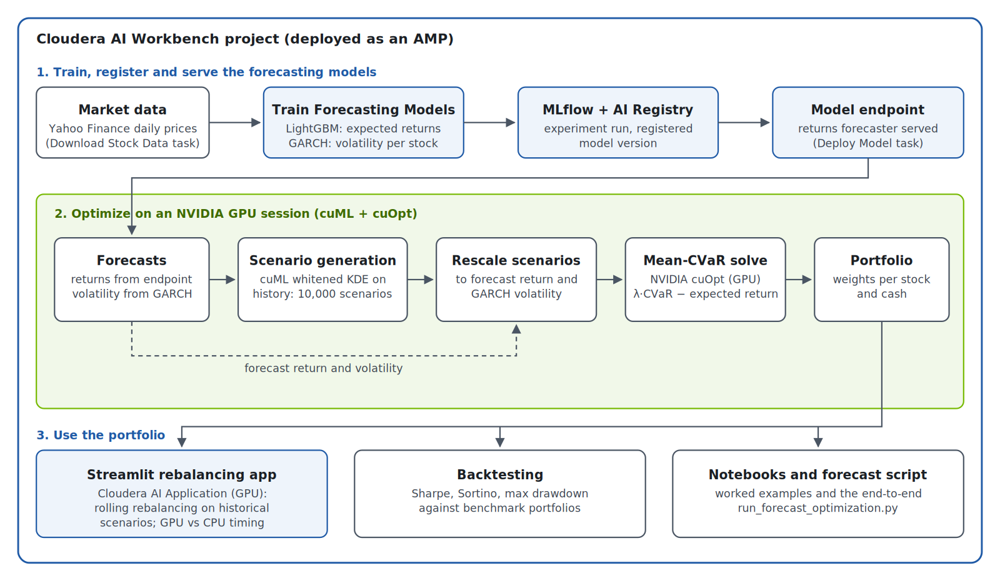

# Cloudera Blueprint: Optimize Investment Portfolios on GPUs

GPU-accelerated Mean-CVaR portfolio optimization on Cloudera AI, adapted from
NVIDIA's cuOpt portfolio optimization example and extended with forecasting
models, model serving and forecast-driven risk scenarios.

## Table of Contents

- [Overview](#overview)
- [Demo](#demo)
- [Use Case](#use-case)
- [Key Features](#key-features)
- [Quickstart / Guide](#quickstart--guide)
- [Architecture / Software Components](#architecture--software-components)
- [Target Audience](#target-audience)
- [Repository Structure](#repository-structure)
- [Prerequisites](#prerequisites)
- [Hardware Requirements](#hardware-requirements)
- [Future Work](#future-work)
- [Documentation](#documentation)

## Overview

This blueprint builds investment portfolios that balance expected return
against tail risk, measured as Conditional Value-at-Risk (CVaR: the average
loss on the worst 5% of days). It runs end to end on Cloudera AI: it
downloads market data, trains and registers forecasting models and serves
the returns model from a Cloudera AI model endpoint (both optional jobs),
simulates 10,000 market
scenarios on the GPU with NVIDIA cuML, and solves the portfolio on the GPU
with NVIDIA cuOpt. The optimization that takes a CPU solver tens of seconds
finishes in under a second, which makes frequent rebalancing and what-if
analysis practical. Everything deploys as a single Cloudera AI AMP, from
data download to a running Streamlit application.

## Demo

TODO: link to a Reprise walkthrough (not recorded yet).

## Use Case

Portfolio managers and risk teams need to rebalance portfolios often, test
many risk settings, and react to changing market conditions. Tail-risk
(CVaR) optimization is the right tool, because it looks at how bad the bad
days get instead of only average volatility, but it is expensive: every
solve considers thousands of simulated market scenarios, and CPU solvers
become the bottleneck.

This blueprint shows how to:

- solve Mean-CVaR problems on the GPU fast enough for interactive use and
  frequent rebalancing;
- feed model forecasts (expected returns and volatility) into both halves of
  the optimization, return and risk, instead of relying on historical
  averages alone;
- run the full lifecycle (train, register, serve, optimize, backtest) inside
  one governed Cloudera AI project.

## Key Features

- **GPU optimization:** Mean-CVaR portfolios solved with NVIDIA cuOpt.
  Measured on an NVIDIA A10G with 380 S&P 500 stocks: 0.55 s versus 45.9 s
  for the CPU solver CLARABEL (83× faster) on 2005–2007 data, and 31× faster
  on 2007–2009 crisis data.
- **GPU scenario generation:** 10,000 return scenarios per solve from a
  kernel density estimate (KDE) on the GPU with NVIDIA cuML. A whitened KDE
  keeps the historical correlation between stocks, so the model does not
  understate how much stocks fall together.
- **Forecast-driven risk:** a LightGBM expected-return model and per-stock
  GARCH volatility models re-center and re-scale every scenario, so the
  optimizer's risk measure reflects the forecast market, not just history.
- **Model lifecycle on Cloudera AI:** training runs logged to MLflow, models
  registered in the AI Registry and, optionally, served from a model
  endpoint that the optimizer calls.
- **Backtesting and rebalancing:** Sharpe ratio, Sortino ratio and maximum
  drawdown against benchmark portfolios, plus rolling rebalancing triggered
  by drift from the target weights, a loss threshold or a drawdown limit.
- **Interactive demo:** a Streamlit application that compares GPU and CPU
  rebalancing live. A toggle switches the backtest from historical
  estimates to forecasts from the bundled models, retrained every 3 months
  on past data only, to show where a customer's own model plugs in.

## Quickstart / Guide

**Deploy as an AMP (recommended)**

1. In Cloudera AI Workbench, create a new project from this repository's Git
   URL. The project file `.project-metadata.yaml` is detected and the AMP
   setup starts automatically.
2. Optionally set `PORTFOLIO_OPT_DATASET` to `dow30` (default, 30 stocks,
   fast), `sp100` or `sp500` (about 380 stocks, slower download). The GPU's
   lead grows with problem size: measured in the demo application against
   its default CPU solver, the GPU solver was about 9x faster on `dow30` and
   about 18x faster on `sp500` (A10G GPU). The 83x under Key Features is a
   single `sp500` solve against the CPU solver CLARABEL.
3. The AMP runs these steps in order:
   1. Install Dependencies
   2. Install GPU Packages (NVIDIA cuOpt and cuML)
   3. Download Stock Data
   4. Create the Train and Register Forecast Models job (created, not run)
   5. Create the Validate GPU Pipeline job (created, not run)
   6. Create the Deploy Forecast Model job (created, not run)
   7. Start the Portfolio Rebalancing Demo application
4. Before starting work, run the **Validate GPU Pipeline** job from the
   project's **Jobs** page. It generates scenarios and solves a small
   portfolio on the GPU in a few seconds, and fails with a clear log if the
   GPU setup is broken. Run it again after changing the runtime or GPU.
5. Optionally, run the **Train and Register Forecast Models** job (logs the
   models to MLflow and registers them in the AI Registry), then the
   **Deploy Forecast Model** job to serve the returns forecaster from a model
   endpoint. The demo application does not need either.
6. Open the application from the project's **Applications** page. To free
   the GPU, the application stops itself after 60 minutes without use; set
   the environment variable `IDLE_SHUTDOWN_MINUTES` to change this (`0`
   turns it off). Restart it from the same page.

**Run the forecast-driven optimization yourself**

Run the **Train and Register Forecast Models** job first. Then, in a GPU
session in the project:

```bash
python scripts/run_forecast_optimization.py --historical-baseline
```

This pulls current prices, gets forecasts from the deployed endpoint (add
`--local` to use the locally trained model if you have not run the Deploy
Forecast Model job), generates and rescales the
scenarios, solves on cuOpt and compares the result with a historical-only
portfolio. `--help` lists every option; the design choices behind them are
in [docs/forecasting_design_decisions.md](docs/forecasting_design_decisions.md).

**Explore the notebooks**

`notebooks/cvar_basic.ipynb` walks through one optimization from raw
prices to backtest; `efficient_frontier.ipynb` and
`rebalancing_strategies.ipynb` build on it; `forecasting_training.ipynb`
covers the forecasting models.

## Architecture / Software Components



| Component | Role |
| --- | --- |
| Cloudera AI Workbench | Projects, GPU sessions, AMP setup tasks, Applications |
| MLflow and Cloudera AI Registry | Experiment tracking and versioned model registration |
| Cloudera AI model endpoint | Serves the returns forecaster to the optimizer |
| NVIDIA cuOpt | GPU solver for the Mean-CVaR linear program |
| NVIDIA cuML | GPU kernel density estimation for scenario generation |
| LightGBM | Expected daily return per stock |
| `arch` (GARCH) | Volatility forecast per stock |
| CVXPY | Optimization modelling layer that hands the problem to cuOpt |
| Streamlit | Interactive rebalancing application |

**How the forecasts reach the optimizer.** The optimizer minimizes
`λ × CVaR − expected return`. The return forecast sets the expected-return
term. Both forecasts also reshape the 10,000 scenarios that CVaR is
measured on: each stock's scenarios are shifted to its forecast return and
stretched to its GARCH volatility.

**About the included forecasting models.** They demonstrate the train →
register → serve → optimize path; they are not a source of returns. In an
out-of-sample test the returns model was no better than predicting the
historical average (52% directional accuracy). Replace them with your own
models; the optimizer only needs a return and a volatility per stock.

## Target Audience

- Portfolio managers and quantitative analysts who want faster, risk-aware
  portfolio construction.
- Risk managers evaluating tail-risk (CVaR) based allocation.
- ML engineers and data scientists deploying financial forecasting models on
  Cloudera AI.
- Solution architects evaluating GPU acceleration for financial workloads.

## Repository Structure

| Path | Description |
| --- | --- |
| `METADATA.yaml` | Catalog metadata for the Cloudera blueprint website |
| `.project-metadata.yaml` | Cloudera AI AMP definition: setup tasks and the application |
| `src/` | Python package `portfolio_optimization`: optimizers, scenario generation, backtesting, rebalancing |
| `src/forecasting/` | Forecasting layer: LightGBM returns, GARCH volatility, scenario rescaling, endpoint client |
| `scripts/` | AMP setup tasks, model training, registration and deployment, and the end-to-end forecast run |
| `notebooks/` | Worked examples |
| `demo/` | Streamlit rebalancing application |
| `tests/` | Unit and GPU benchmark tests |
| `assets/` | Architecture diagram |
| `docs/` | Design decisions and NVIDIA's original README |
| `ci/` | Continuous integration scripts |
| `data/` | Downloaded price data (not committed) |

## Prerequisites

- Cloudera AI Workbench with access to NVIDIA GPU runtimes (the AMP uses the
  PBJ Workbench, Python 3.12, NVIDIA GPU edition runtime) and a GPU resource
  quota.
- Permission to create models, model endpoints and applications, and access
  to the AI Registry.
- Outbound internet access from the workspace to PyPI, the NVIDIA package
  index (`pypi.nvidia.com`) and Yahoo Finance.
- Git, to import the repository.

## Hardware Requirements

| Deployment | Minimum |
| --- | --- |
| Demo / AMP | 1 NVIDIA GPU with CUDA 12 support (tested on an NVIDIA A10G, 24 GB), 2 vCPU, 16 GB RAM for the application session |
| Production / large universes | NVIDIA H100 class GPU recommended by NVIDIA for large problems; 32+ CPU cores, 64+ GB RAM, 100+ GB storage |

The optimizer always solves on the GPU; there is no CPU fallback. Of the
AMP steps, only the application requests a GPU; the others run on CPU only.
The Validate GPU Pipeline job requests one when you run it.

## Future Work

- **Forecast risk calibration backtest.** A walk-forward test that, at each
  rebalance date, records the Value at Risk (VaR) and CVaR the optimizer
  predicted and compares them with the losses that actually followed: how
  often losses exceeded the predicted VaR, and how the average loss on those
  days compares with the predicted CVaR. The result would feed back as a
  volatility scaling factor for the GARCH forecasts. The existing backtester
  measures portfolio performance (Sharpe, Sortino, drawdown) but does not
  check whether the forecast risk numbers were accurate. Not yet started; it
  needs a GPU session to run.

## Documentation

- [Forecasting design decisions](docs/forecasting_design_decisions.md): how
  risk aversion is scaled, how forecasts reshape the scenarios, and why the
  scenarios use a whitened KDE.
- [NVIDIA's original README](docs/NVIDIA_README.md): the underlying package,
  local Docker and `uv` installation, detailed system requirements.
- [Streamlit application](demo/README_streamlit.md)
- [Change log](CHANGELOG.md)
- [NVIDIA cuOpt documentation](https://docs.nvidia.com/cuopt/)
- [Cloudera AI documentation](https://docs.cloudera.com/machine-learning/cloud/index.html)

## License

Apache License 2.0, see [LICENSE](LICENSE). Based on NVIDIA's portfolio
optimization example; third-party licenses are listed in
[LICENSE-3rd-party.txt](LICENSE-3rd-party.txt).
